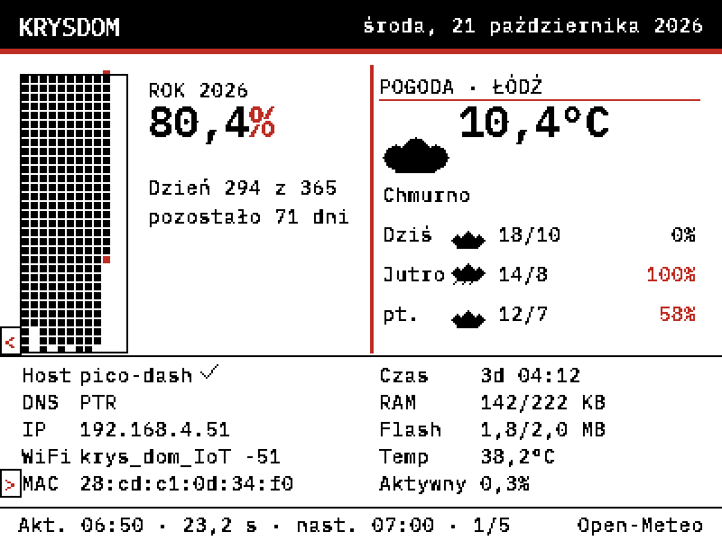
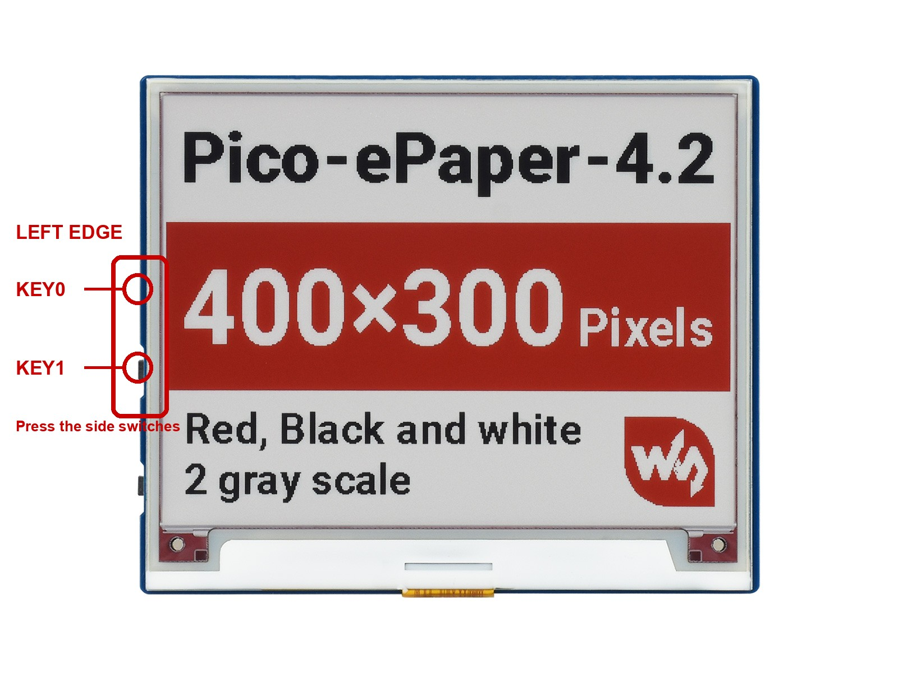
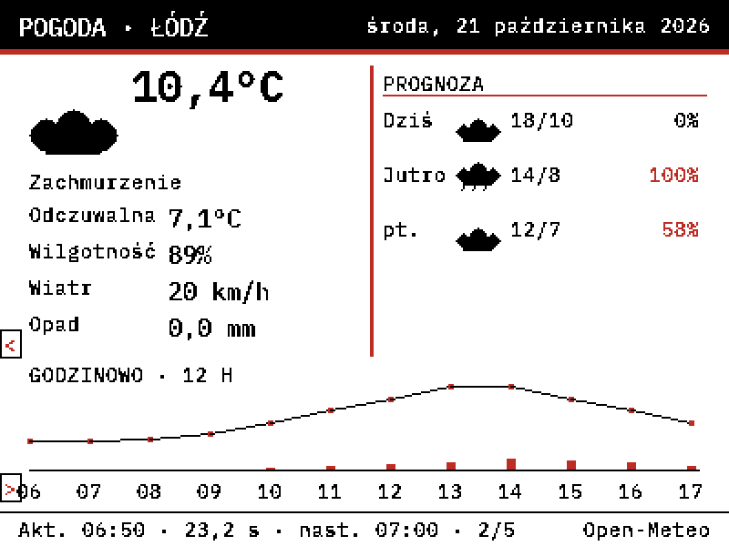
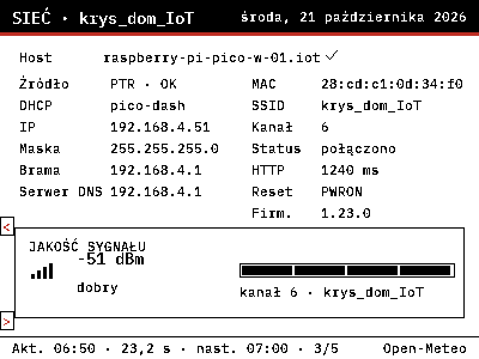
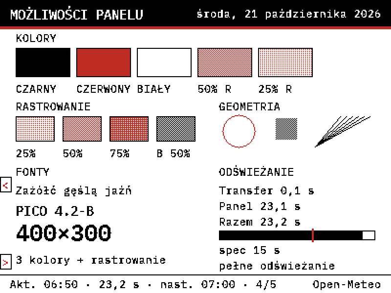
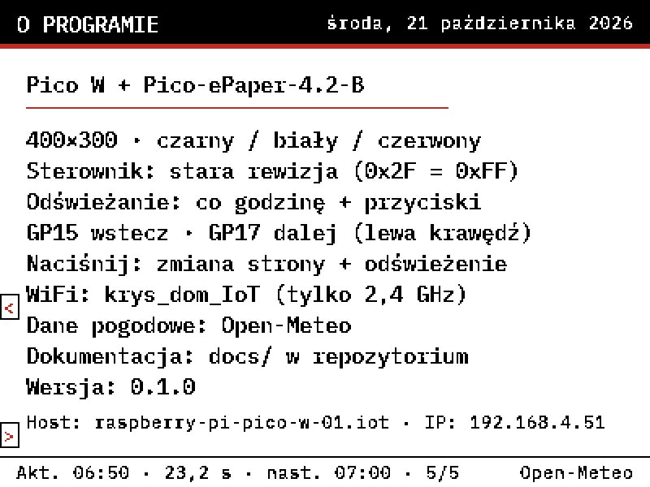

# Pico W e-Paper Dashboard (Pico-ePaper-4.2-B)

Self-contained MicroPython experiment that turns a Pico W and a Waveshare
**Pico-ePaper-4.2-B** (400 × 300, black/white/red) into a home dashboard for
Łódź: year progress, weather forecast, network identity, uptime/heap/flash,
and a capability/refresh page.

The panel has no partial refresh and no true grayscale. A full frame takes
**15.8–23.2 s** on this older unit, so there is deliberately **no clock**.
Updates happen **every hour at the top of the hour**, and (when the physical
buttons are working) on a key press.



## Hardware

- Raspberry Pi Pico W (RP2040), MicroPython 1.23.0.
- Waveshare Pico-ePaper-4.2-B, 4.2 inch, 400 × 300, red/black/white.
- USB data cable; the module is powered from VSYS.
- No Raspberry Pi host is involved; all data comes from the Pico itself.

| e-Paper | Pico pin | GPIO |
| --- | --- | --- |
| VCC | VSYS | — |
| GND | GND | — |
| DIN | 14 | GP11 |
| CLK | 15 | GP10 |
| CS | 12 | GP9 |
| DC | 11 | GP8 |
| RST | 13 | GP12 |
| BUSY | 16 | GP13 |

The two user switches are **KEY0 → GP15** and **KEY1 → GP17**, to GND. They are
the two side-actuated tactile switches on the **left PCB edge** of the module.
They are **verified on this unit**: KEY0 goes to the previous page, KEY1 to the
next page. The e-paper has no touch controller, so tapping the printed markers
does nothing. External momentary switches on GP15/GP17 also work, and the
hourly refresh does not depend on any button.

## Board safety

The board already contains a school-timetable program in `main.py` plus a
`lib/` directory. This experiment runs **without writing to the board**:

```sh
.venv/bin/mpremote mount . run main.py
```

Deploying (`mpremote fs cp ...`) is **not** part of the normal workflow. If
you decide to deploy, back up `:main.py` and `:lib/` first and verify the copy.
Never overwrite `:main.py` without an explicit decision.

## Setup

```sh
cd experiments/pico-2-w-epaper-dashboard
python3 -m venv .venv
.venv/bin/pip install -r requirements.txt
cp secrets.example.py secrets.py
# edit secrets.py: WIFI_PASSWORD = "..."
.venv/bin/mpremote connect list
```

`secrets.py` is gitignored and is never printed or committed. The SSID is
fixed in `config.py` to **`krys_dom_IoT`**; there is no fallback to another
network. The Pico W only supports 2.4 GHz and WPA2; the IoT SSID must allow
DNS and outbound HTTP/HTTPS (NTP is optional).

The Pico's MAC is `28:cd:c1:0d:34:f0` on this unit; the router has a static
DHCP reservation for it. The DNS PTR lookup found
`raspberry-pi-pico-w-01.iot` and verified it against `192.168.4.51`.

## Run

```sh
.venv/bin/mpremote mount . run main.py
```

Expected sequence:

1. ~20 s vendor init + clear (the panel flashes).
2. Wi-Fi, NTP/HTTP-Date, DNS PTR, Open-Meteo fetch.
3. One full dashboard refresh (~16–23 s).
4. The panel shows the dashboard; the loop waits for the next hour or a button.

`First frame` is the last startup log line. After it the loop is intentionally
silent until a button event or the hourly refresh; the program has not stopped.

First boot is typically **45–60 s**. The panel stays awake between updates.
`Ctrl-C` stops the script without altering the image.

### Pages

1. **KRYSDOM** — year grid/percentage, 3-day weather, network, system.
2. **Pogoda** — current details, 3-day forecast, 12-hour chart.
3. **Sieć** — full DNS name and verification, IP, gateway, MAC, SSID, RSSI,
   HTTP timing, reset cause, firmware.
4. **Możliwości** — colour swatches, dither charts, fonts, geometry, refresh
   telemetry.
5. **O programie** — panel facts, button legend, sources, version.

GP15 = previous, GP17 = next; any press changes the page and refreshes.
The hourly refresh refreshes the current page.
Every page shows red `<` and `>` hints in black-outlined boxes on the left
edge, at the KEY0 and KEY1 heights. **The e-paper is not a touchscreen**: the
markers are printed hints only. Tapping the glass does nothing; the input is
only the two side-actuated switches on the left PCB edge.

If a unit's switches do not respond, run the raw diagnostic and press the two
side-mounted switches on the left edge of the module:

```sh
.venv/bin/mpremote mount . run button_diag.py
```

`GP15/GP17` should go from `1` to `0`. The annotated location is:



For a wider check, `pin_scan.py` scans every free GPIO with pull-ups and then
pull-downs; any transition identifies the real pin or polarity. A scan that
never changes means no switch closure is reaching the Pico.

If a unit's side switches are unavailable, show any page directly:

```sh
# edit PAGE at the top of show_page.py: 0 dashboard, 1 weather,
# 2 network, 3 capabilities, 4 about
.venv/bin/mpremote mount . run show_page.py
```

### Configuration

`config.py` contains the SSID, hostname, Łódź coordinates, timezone, refresh
policy, pin map and UI options. `RUN_ONCE = True` is a one-frame test switch;
leave it `False` for the loop.

## Demo and preview

```sh
# Capability demo without Wi-Fi or secrets
.venv/bin/mpremote mount . run demo.py

# Host-rendered PNGs (no panel, no Pico)
python3 tools/preview.py --frame all --scale 2

# Pure-Python tests
python3 -m unittest discover -s tools -p 'test_*.py'
```

The demo shows the bring-up pattern, a 16-level red/white and black/white
dither chart, and the capabilities page.

| | |
| --- | --- |
|  |  |
|  |  |

## Documentation

- [`docs/pico-epaper-4.2-b.md`](docs/pico-epaper-4.2-b.md) — verified panel
  specs, pinout, protocol, old/V2 commands, refresh behaviour, measured timings.
- [`docs/dashboard.md`](docs/dashboard.md) — architecture, DNS discovery,
  refresh policy, pages, memory strategy, limitations.
- [`docs/weather.md`](docs/weather.md) — Open-Meteo fields, WMO mapping,
  caching, time fallback, attribution.
- [`docs/third-party.md`](docs/third-party.md) — datasheet/font/API notices.
- [`docs/datasheets/`](docs/datasheets/) — mirrored old manual, V2 manual and
  schematic with SHA-256 checksums.

## OpenSpec

This experiment owns its OpenSpec root. Run from the experiment directory:

```sh
openspec status --change pico-2-w-epaper-dashboard
openspec validate pico-2-w-epaper-dashboard --strict
```

## Known limitations

- Full refresh only; no partial update, no true grayscale, no live clock.
- 15.8–23.2 s per frame; hourly updates only (plus buttons).
- First boot has two full waveforms (clear + dashboard).
- Physical KEY0/KEY1 side switches verified: KEY0 previous, KEY1 next.
  The panel is not touch; external switches on GP15/GP17 also work.
- The dashboard shows the short DHCP name `pico-dash`; the full DNS name is on
  the Network and About pages.
- TLS certificate verification is not pinned; the weather client falls back to
  HTTP if the handshake fails.
- The IoT WLAN must permit DNS and outbound weather traffic.
