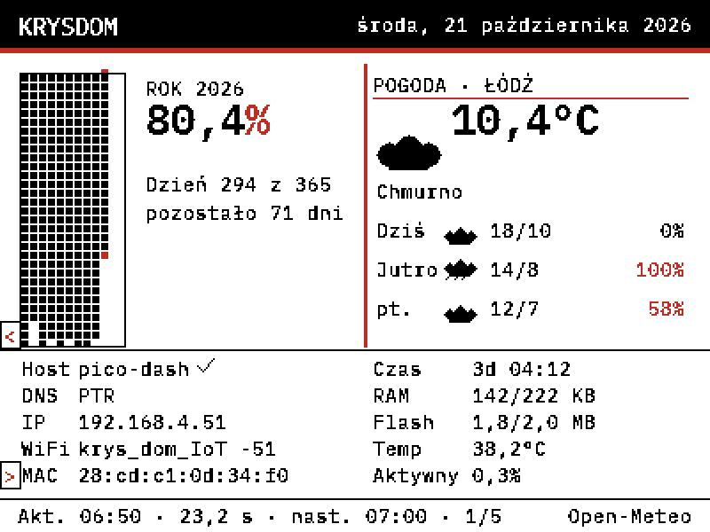
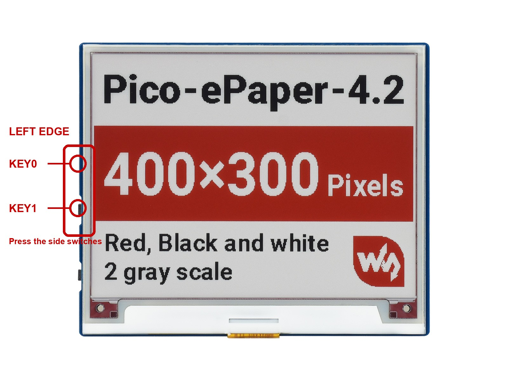
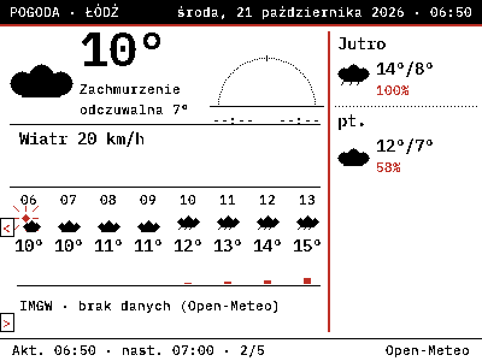
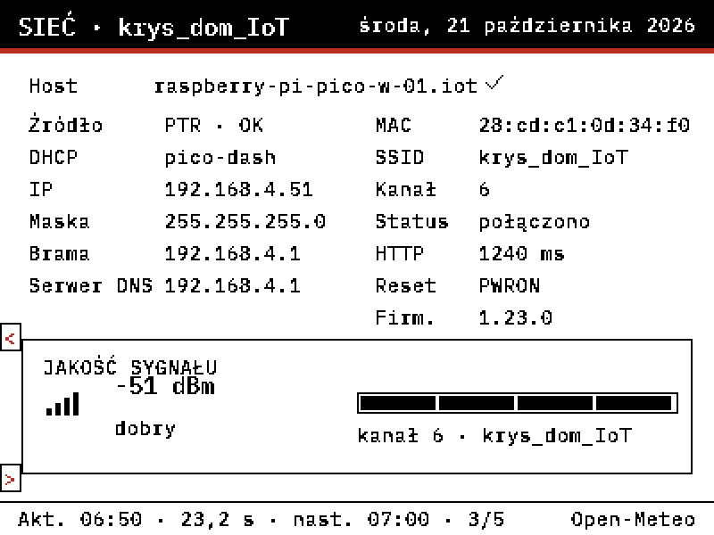
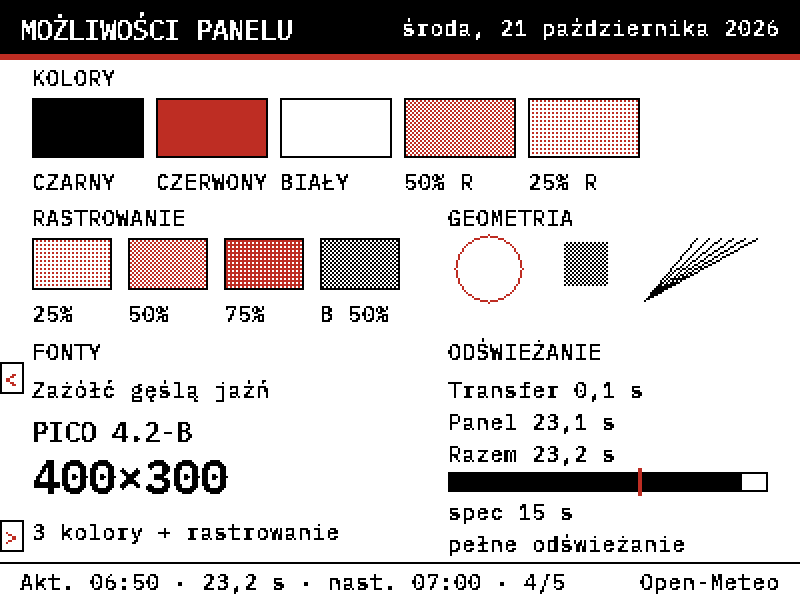
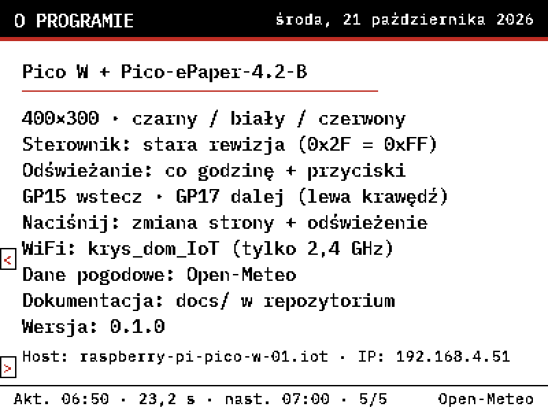

# Pico W e-Paper Dashboard (Pico-ePaper-4.2-B)

Self-contained MicroPython experiment that turns a Pico W and a Waveshare
**Pico-ePaper-4.2-B** (400 × 300, black/white/red) into a home dashboard for
Łódź: year progress, weather forecast, network identity, uptime/heap/flash,
and a capability/refresh page.

The panel has no partial refresh and no true grayscale. A full frame takes
**15.8–23.2 s** on this older unit, so there is deliberately **no clock**.
Updates happen **every hour at the top of the hour**, and (when the physical
buttons are working) on a key press.



## Hardware

- Raspberry Pi Pico W (RP2040), MicroPython 1.23.0.
- Waveshare Pico-ePaper-4.2-B, 4.2 inch, 400 × 300, red/black/white.
- USB data cable; the module is powered from VSYS.
- No Raspberry Pi host is involved; all data comes from the Pico itself.

| e-Paper | Pico pin | GPIO |
| --- | --- | --- |
| VCC | VSYS | — |
| GND | GND | — |
| DIN | 14 | GP11 |
| CLK | 15 | GP10 |
| CS | 12 | GP9 |
| DC | 11 | GP8 |
| RST | 13 | GP12 |
| BUSY | 16 | GP13 |

The two user switches are **KEY0 → GP15** and **KEY1 → GP17**, to GND. They are
the two side-actuated tactile switches on the **left PCB edge** of the module.
They are **verified on this unit**: KEY0 goes to the previous page, KEY1 to the
next page. The e-paper has no touch controller, so tapping the printed markers
does nothing. External momentary switches on GP15/GP17 also work, and the
hourly refresh does not depend on any button.

## Board safety

The dashboard is **installed** on the board (since 2026-11-08) and starts on
every power-up. The previous programs are backed up (gitignored):

- `backups/pico-w-main-*.py` — earlier `:main.py` files (LED blink).
- `backups/pico-w-lib-20261108/` — the old board `/lib` (~600 KB of unused
  Adafruit/CPython packages), removed because the flash was full.
- `../pico-1-w-led-blink/backups/pico-w-main.py` — the original 22 KB
  timetable program.

Restore any of them with `mpremote fs cp <backup> :main.py` (or `fs cp -r`)
from a maintenance boot, then reset.

**Connecting `mpremote` interrupts the running dashboard** (Ctrl-C) and the
board reboots once into a maintenance REPL; the first mpremote command fails
with "Device not configured" — rerun it. Reset or power-cycle to resume.

## Setup

```sh
cd experiments/pico-2-w-epaper-dashboard
python3 -m venv .venv
.venv/bin/pip install -r requirements.txt
cp secrets.example.py secrets.py
# edit secrets.py: WIFI_PASSWORD = "..."
.venv/bin/mpremote connect list
```

`secrets.py` is gitignored and is never printed or committed. The SSID is
fixed in `config.py` to **`krys_dom_IoT`**; there is no fallback to another
network. The Pico W only supports 2.4 GHz and WPA2; the IoT SSID must allow
DNS and outbound HTTP/HTTPS (NTP is optional).

The Pico's MAC is `28:cd:c1:0d:34:f0` on this unit; the router has a static
DHCP reservation for it. The DNS PTR lookup found
`raspberry-pi-pico-w-01.iot` and verified it against `192.168.4.51`.

## Run

### Installed (autostart)

```sh
tools/deploy.sh          # build .mpy, back up :main.py, copy, reset
```

`tools/deploy.sh` enters maintenance mode, backs up and verifies `:main.py`,
runs `tools/build.py` (precompiles `lib/` with mpy-cross **1.23.0**, matching
the firmware) and copies `build/` to the board. `main.py` on the board is a
3-line shim; everything else is `.mpy`.

On every power-up:

1. Hardware watchdog armed; Wi-Fi association starts in the background.
2. ~24 s vendor init + clear (the panel flashes).
3. NTP (or the HTTP `Date` header), DNS PTR, Open-Meteo fetch, first frame.
4. Hourly refresh at the top of the hour; KEY0/KEY1 change pages.

If the network is not up yet (typical after a power cut, when the router boots
slower than the Pico), the last weather persisted to flash is shown marked
stale and the network is retried after 60 s, 2, 5, 10 and every 15 min; the
panel is redrawn only once fresh data arrives.

### Resilience

| Failure | Recovery |
|---|---|
| Power cut | Autostart; cached weather (`/weather.json`, written atomically) until online |
| App hangs (no heartbeat 300 s) | Hardware watchdog reset (`reset_cause=WDT`) |
| C-level hang | Watchdog reset within ~8 s |
| Uncaught exception | Logged, reset after 30 s, doubling per crash up to 15 min |
| Wi-Fi fails | Radio re-init every 2 failures, board reboot after 12 |
| Panel BUSY stuck | `OSError` after 45 s instead of hanging |

Deliberate resets are tagged in a watchdog scratch register, so `reset_cause`
reads `CRASH`, `MAINT`, `WIFI`, `DEPLOY` or `MEM` instead of `WDT`.

### Maintenance mode

One boot without the dashboard and without the watchdog, for `mpremote`:

- send Ctrl-C (any `mpremote` command does) — the app writes `/maint` and
  reboots, or
- hold **KEY0** while plugging in power.

The next reset or power cycle returns to the dashboard.

### Observability

- `http://raspberry-pi-pico-w-01.iot:9100/metrics` — Prometheus text:
  `pico_uptime_seconds`, `pico_heap_{free,used}_bytes`,
  `pico_flash_{used,total}_bytes`, `pico_cpu_temperature_celsius`,
  `pico_cpu_active_ratio` (load), `pico_wifi_{connected,rssi_dBm}`,
  `pico_wifi_connects_total`, `pico_boot_info{reset_cause,crash_count,...}`,
  `dashboard_refreshes_total{trigger,result}`,
  `dashboard_refresh_duration_milliseconds{stage}`,
  `dashboard_last_refresh_time_seconds`, `dashboard_weather_age_seconds`,
  `dashboard_weather_fetches_total{result}`, `dashboard_button_presses_total`.
- `/healthz` — JSON; 200 while a frame was shown in the last 2 h, else 503.
- observatory.k3s scrapes `/metrics` through the collector's `prometheus/apps`
  relay as `job="pico-epaper-dashboard"` (krysdom-api `observability/values.yaml`).

### Firmware and memory

The board runs **MicroPython v1.23.0 built with `lib/` frozen into flash**
(`firmware/manifest.py`). Frozen bytecode and the font/table constants run
from flash, so the running app has ~113 KB of heap free instead of ~60 KB.
`config.mpy`, `secrets.py`, `certs/` and the `main.py` shim stay on the
filesystem, so configuration changes need only `tools/deploy.sh`; **code
changes in `lib/` need a firmware rebuild and flash**:

```sh
firmware/build.sh      # Docker (Debian, gcc-arm-none-eabi); cache in firmware/.cache
firmware/flash.sh      # machine.bootloader() + copy UF2, no BOOTSEL press needed
tools/deploy.sh        # config/secrets/certs/main.py; detects the frozen firmware
```

The UF2 ends at 880 KB; the LittleFS region starts at 1200 KB and is never
touched by flashing. Roll back to stock firmware with
`firmware/flash.sh backups/RPI_PICO_W-20240602-v1.23.0.uf2`, then
`tools/deploy.sh` (it then copies `lib/*.mpy` again). If the board does not
come back, hold BOOTSEL while plugging in USB and copy a UF2 to `RPI-RP2`
with `cp -X` (plain `cp` fails on macOS).

### OTLP push (prepared, off)

`lib/telemetry.py` pushes OTLP/HTTP JSON metrics, logs (Loki) and refresh
traces (Tempo) to `https://otel.k3s`, verified against the krysdom CA
(`certs/k3s-ca.der`), as `service.name=pico-epaper-dashboard`. On the frozen
firmware a trial run delivered all three signals in ~1.8 s and the series
appeared in Prometheus. It stays off (`OTLP_ENABLED = False`). To enable:
set it to `True`, run `tools/deploy.sh`, and remove the
`pico-epaper-dashboard` scrape job in krysdom-api so the series are not
duplicated. Without the frozen firmware the heap fragments too much for TLS
(largest free block ~10 KB). Weather uses plain HTTP for the same reason.

### From the host (no install)

```sh
.venv/bin/python tools/build.py
.venv/bin/mpremote mount build run build/main.py
```

Source runs (`mpremote mount . run main.py`) compile ~100 KB on the board and
may run out of heap; prefer `build/`.

### Pages

1. **KRYSDOM** — year grid/percentage, 3-day weather, network, system.
2. **Pogoda** — current details, 3-day forecast, 12-hour chart.
3. **Sieć** — full DNS name and verification, IP, gateway, MAC, SSID, RSSI,
   HTTP timing, reset cause, firmware.
4. **Możliwości** — colour swatches, dither charts, fonts, geometry, refresh
   telemetry.
5. **O programie** — panel facts, button legend, sources, version.

GP15 = previous, GP17 = next; any press changes the page and refreshes.
The hourly refresh refreshes the current page.
Every page shows red `<` and `>` hints in black-outlined boxes on the left
edge, at the KEY0 and KEY1 heights. **The e-paper is not a touchscreen**: the
markers are printed hints only. Tapping the glass does nothing; the input is
only the two side-actuated switches on the left PCB edge.

If a unit's switches do not respond, run the raw diagnostic and press the two
side-mounted switches on the left edge of the module:

```sh
.venv/bin/mpremote mount . run button_diag.py
```

`GP15/GP17` should go from `1` to `0`. The annotated location is:



For a wider check, `pin_scan.py` scans every free GPIO with pull-ups and then
pull-downs; any transition identifies the real pin or polarity. A scan that
never changes means no switch closure is reaching the Pico.

If a unit's side switches are unavailable, show any page directly:

```sh
# edit PAGE at the top of show_page.py: 0 dashboard, 1 weather,
# 2 network, 3 capabilities, 4 about
.venv/bin/mpremote mount . run show_page.py
```

### Configuration

`config.py` contains the SSID, hostname, Łódź coordinates, timezone, refresh
policy, pin map and UI options. `RUN_ONCE = True` is a one-frame test switch;
leave it `False` for the loop.

## Demo and preview

```sh
# Capability demo without Wi-Fi or secrets
.venv/bin/mpremote mount . run demo.py

# Host-rendered PNGs (no panel, no Pico)
python3 tools/preview.py --frame all --scale 2

# Pure-Python tests
python3 -m unittest discover -s tools -p 'test_*.py'
```

The demo shows the bring-up pattern, a 16-level red/white and black/white
dither chart, and the capabilities page.

| | |
| --- | --- |
|  |  |
|  |  |

## Documentation

- [`docs/pico-epaper-4.2-b.md`](docs/pico-epaper-4.2-b.md) — verified panel
  specs, pinout, protocol, old/V2 commands, refresh behaviour, measured timings.
- [`docs/dashboard.md`](docs/dashboard.md) — architecture, DNS discovery,
  refresh policy, pages, memory strategy, limitations.
- [`docs/weather.md`](docs/weather.md) — Open-Meteo fields, WMO mapping,
  caching, time fallback, attribution.
- [`docs/third-party.md`](docs/third-party.md) — datasheet/font/API notices.
- [`docs/datasheets/`](docs/datasheets/) — mirrored old manual, V2 manual and
  schematic with SHA-256 checksums.

## OpenSpec

This experiment owns its OpenSpec root. Run from the experiment directory:

```sh
openspec status --change pico-2-w-epaper-dashboard
openspec validate pico-2-w-epaper-dashboard --strict
```

## Known limitations

- Full refresh only; no partial update, no true grayscale, no live clock.
- 15.8–23.2 s per frame; hourly updates only (plus buttons).
- First boot has two full waveforms (clear + dashboard).
- Physical KEY0/KEY1 side switches verified: KEY0 previous, KEY1 next.
  The panel is not touch; external switches on GP15/GP17 also work.
- The dashboard shows the short DHCP name `pico-dash`; the full DNS name is on
  the Network and About pages.
- TLS certificate verification is not pinned; the weather client falls back to
  HTTP if the handshake fails.
- The IoT WLAN must permit DNS and outbound weather traffic.
